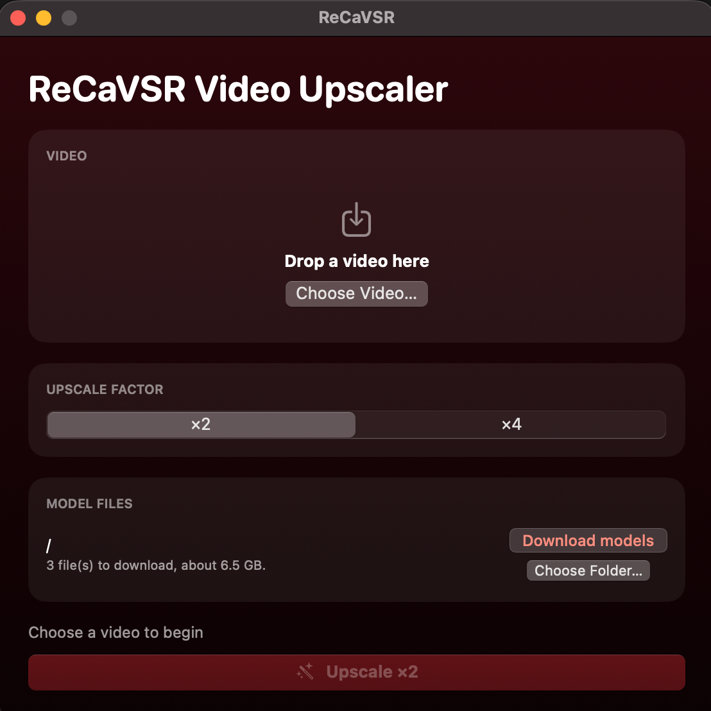
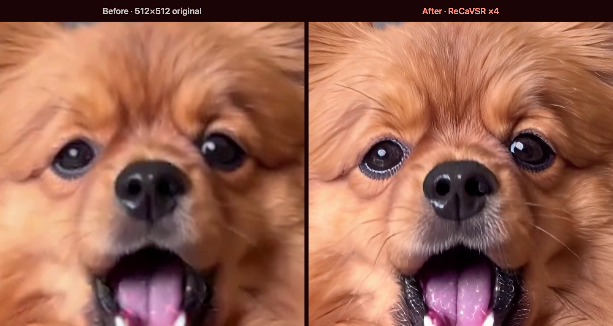

# ReCaVSR Video Upscaler

A macOS app (Apple Silicon, macOS 14+) that upscales a video ×2 or ×4 with
[ReCaVSR](https://github.com/kopperx/ReCaVSR), a one-step streaming video super-resolution
model, running on Comfy engine with the int8-Fast node in the background.

<p align="center"></p>

## What it does

A 512×512 video, upscaled ×4 to 2048×2048 by this app. The same frame, the same part of it at
full size; on the left the original, scaled up the usual way (bicubic):



## Install

Needs a Mac with Apple Silicon and macOS 14 or later. 32 GB of memory or more is
recommended for HD video.

1. Download the latest `ReCaVSR-<version>.dmg` from the
   [Releases](../../releases) page, open it, and drag **ReCaVSR** to **Applications**.
2. The app is not notarized by Apple, so the first time macOS blocks it. Open it once,
   then go to **System Settings ▸ Privacy & Security** and click **Open Anyway** next to
   ReCaVSR. After that it opens normally.
3. Choose a folder for the model files and click **Download models** (about 6.5 GB).

Everything else, including the Comfy engine and the ReCaVSR nodes, is inside the app. No
ComfyUI installation is needed.

## Build from source

Only needed if you want to build the app yourself; the DMG above already contains
everything. You don't need ComfyUI installed: the build downloads what it needs.

Requires Xcode (or the Command Line Tools), [`uv`](https://docs.astral.sh/uv/) and git.

```bash
./scripts/build_app.sh       # builds build/ReCaVSR.app
./scripts/make_dmg.sh        # optional: build/ReCaVSR-<version>.dmg
```

The first build takes a few minutes and downloads about 1 GB: `scripts/build_engine.sh`
stages the engine that goes inside the app, in `build/engine-stage`. Later builds reuse
it; delete that folder to stage it again. The engine is:

- a standalone Python 3.13 (fetched by `uv`), with PyTorch 2.15.0, PyAV 17.0.1, OpenCV and
  ComfyUI's requirements;
- [ComfyUI](https://github.com/Comfy-Org/ComfyUI) at a pinned commit (0.45.0 plus a few
  commits; the ReCaVSR nodes need 0.44 or later);
- the [ComfyUI-ReCaVSR](https://github.com/PedroMarinhoDev/ComfyUI-ReCaVSR) nodes at a pinned
  commit (2.0.0), with this app's two patches from `engine_patches/` applied:
  - **Apple Silicon**: the nodes' attention kernels are written in Triton, which runs only on
    NVIDIA cards; the patch adds a tiled PyTorch version for the Mac's GPU, and works around two
    things MPS lacks (float64, and boolean masks in ComfyUI's attention there);
  - **colour**: the nodes read a BT.709 video with the BT.709 matrix but wrote the result with
    BT.601 and no colour label, which shifts saturated colours. The patch writes with the
    input's matrix and copies its colour labels, so the upscale shows the original's colours;
- the [ComfyUI-AppleSilicon-int8-Fast](https://github.com/Illuminus7/ComfyUI-AppleSilicon-int8-Fast)
  node at a pinned commit (release 1.2.0), which runs the int8 transformer on the Mac's GPU.

The pinned versions are at the top of `scripts/build_engine.sh`. To build from local
copies instead, set `COMFY_SRC` to a ComfyUI folder (and `INT8_SRC`, `RECAVSR_SRC` to the
node folders).

### Signing

By default the app is signed ad-hoc, which runs on the Mac that built it; other Macs
block it until they allow it under Privacy & Security. To share it more smoothly, sign with
a Developer ID and notarize:

```bash
SIGN_IDENTITY="Developer ID Application: Your Name (TEAMID)" NOTARY_PROFILE=recavsr ./scripts/build_app.sh
```

Create the notary profile once with `xcrun notarytool store-credentials recavsr`.
The engine's binaries are signed with the hardened runtime and the exceptions in
`Resources/engine.entitlements`. This path has not been tested yet.

## How it works

1. **Video**: choose or drop an MP4, MOV or M4V. The file is checked when it is
   chosen. The result is always saved as `<name> upscaled.mp4` in the same folder
   (a number is added if the name is taken), with the original audio. Audio MP4 players
   don't expect, such as the PCM in many MOV files, is converted to AAC. A phone video's
   rotation is kept.
2. **Models**: three files, stored in a folder you pick, in ComfyUI's layout (`recavsr/`):

   | File | Size | From |
   |---|---|---|
   | `transformer_int8_convrot.safetensors` | 6.27 GB | [PedroMarinhoDev/ReCaVSR-ComfyUI](https://huggingface.co/PedroMarinhoDev/ReCaVSR-ComfyUI) |
   | `flashdecoder.safetensors` | 229 MB | [kopper/ReCaVSR](https://huggingface.co/kopper/ReCaVSR) |
   | `prompt.safetensors` | 4.2 MB | [kopper/ReCaVSR](https://huggingface.co/kopper/ReCaVSR) |

   The int8 transformer is a conversion of kopper/ReCaVSR's 10.6 GB bf16 release: smaller, and
   faster on Apple Silicon with int8-Fast. An existing ComfyUI `models` folder works as-is;
   picking its `recavsr` folder, or the ComfyUI folder above it, is corrected automatically.
3. **Downloads**: four parts per file at the same time, resumable after Cancel or a quit.
   Parts are named with the file's hash, so parts of an older upload are never mixed in.
   The joined file is checked against Hugging Face's SHA-256 before it is used, and free
   space is checked first.
4. **Upscaling**: one ComfyUI run of the ComfyUI-ReCaVSR example workflow (Load Video →
   ReCaVSR Upscale Video → Save Video) with the int8 transformer, the FlashDecoder, fast
   kernels, seed 42 and no colour fix. ReCaVSR streams: it upscales 21 frames, then 8 at a
   time, and encodes each block as soon as it is decoded, so a longer video costs time and
   disk, not memory. ×4 is what the model was trained for; ×2 is the reference's other setting.
5. **Engine**: the bundled ComfyUI runs headless on a free localhost port. It stays
   loaded for five minutes after a job so the next one starts quickly, then stops.
   Only one copy of the app runs at a time; leftovers from a crash (engine processes,
   work files, half-joined downloads) are cleared at the next launch.

ReCaVSR treats a video as one shot: right after a scene cut, the first blocks still draw on
the previous shot, which can show as shimmer for a moment. Upscale each shot on its own when
that matters.

## Logs and temporary files

- The app writes no log files. The engine's output is kept as a short tail in memory
  and shown only in error messages.
- Model downloads are written as parts next to the final file, then joined.
- During a job, the video is hard-linked (or copied, if it is on another volume) into
  `~/Library/Application Support/ReCaVSR/input`; ReCaVSR writes the upscaled video into
  `…/temp/recavsr`, and Save Video copies it to `…/output`. All of these are deleted when the
  job ends, and the work folders are cleared again at launch.

## Requirements

- To build: Xcode or the Command Line Tools, `uv` and git (see Build from source).
- To run: macOS 14 on Apple Silicon. About 6.5 GB of model files, downloaded on
  first use to the folder you choose.

## License

The app's own code (everything in this repository except `engine_patches/`) is under the
[MIT License](LICENSE), which ships inside the app (`Contents/Resources/LICENSE`) and the DMG. The patches in `engine_patches/` change ComfyUI-ReCaVSR and follows its
licenses (GPL-3.0, and Apache-2.0 for the ported ReCaVSR model code).

The built app bundles other software under its own licenses, and sharing the built app
means following them: ComfyUI (GPL-3.0), ComfyUI-ReCaVSR (GPL-3.0 and Apache-2.0), the
ComfyUI-AppleSilicon-int8-Fast node (MIT), PyTorch (BSD-3-Clause), OpenCV (Apache-2.0),
Python (PSF License) and the Python packages ComfyUI installs. The model files are not part
of the app; they are downloaded from Hugging Face under their own terms (kopper/ReCaVSR states
no licence for the weights; the int8 file is converted from them and follows their terms).
ReCaVSR is by Xijun Wang, Xin Li, Suhang Yao, Zirui Lang, Bingchen Li and Zhibo Chen,
University of Science and Technology of China.
